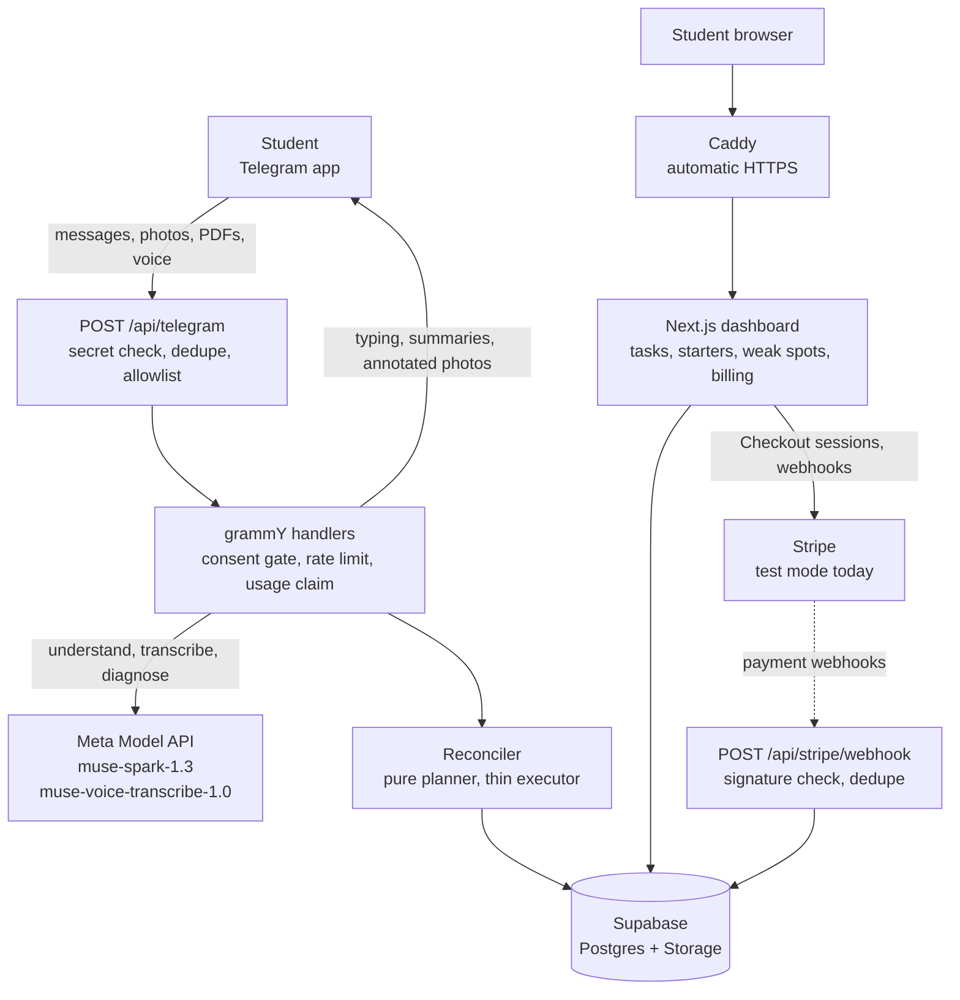
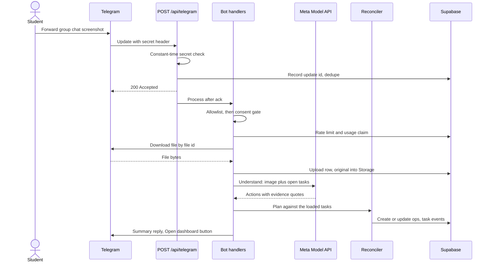
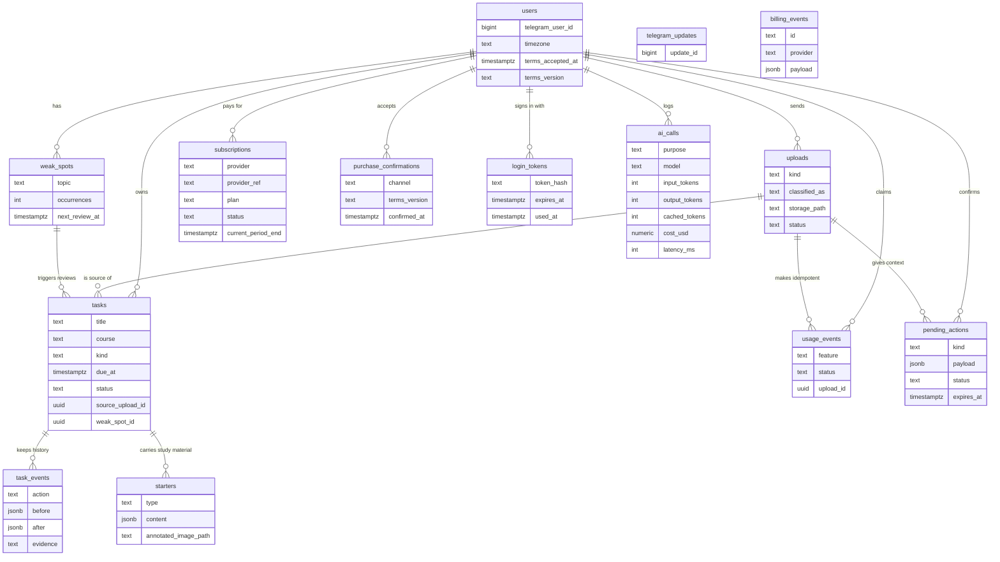

<p align="center">
  
</p>

# Settle

<p align="center">Settle turns deadline chaos in students' Telegram chats into one calm task list,<br/>then does the first step of every task.</p>

<p align="center">
  
  &nbsp;
  
  &nbsp;
  
  &nbsp;
  
  &nbsp;
  
  &nbsp;
  
</p>

<p align="center">
  <a href="#the-problem">The problem</a> &middot;
  <a href="#features">Features</a> &middot;
  <a href="#architecture">Architecture</a> &middot;
  <a href="#ai-design">AI design</a> &middot;
  <a href="#tech-stack">Tech stack</a> &middot;
  <a href="#project-layout">Project layout</a> &middot;
  <a href="#getting-started">Getting started</a> &middot;
  <a href="#deployment">Deployment</a> &middot;
  <a href="#testing-and-quality">Testing</a> &middot;
  <a href="#security-and-privacy">Security</a> &middot;
  <a href="#documentation">Docs</a> &middot;
  <a href="#status-and-roadmap">Roadmap</a>
</p>

Built for the Meta hackathon theme "Build for Your World", for Singapore students who live in Telegram. One Telegram bot, one web dashboard, one task list.

## The problem

Students don't fail because they can't do the work; they lose track of it. Deadlines sit in group chats, briefs run 30 pages, slides pile up, and mistakes in practice papers go unnoticed until the exam. Remembering what to do eats the energy that learning needs.

Settle takes the remembering over. You forward it anything a course throws at you, it keeps one prioritised list, and every item arrives with its first step already done: a checklist for the brief, flashcards from the slides, the first wrong math step circled. Weak spots come back on purpose, on a schedule, before the exam instead of the night before.

## Features

Everything below is implemented in this repo and covered by the test suite. Numbers come from the code: plan quotas from `lib/billing/plans.ts`, limits from `lib/telegram/limits.ts` and `lib/media/`, schedules from `lib/weakspots/schedule.ts`.

### Chat capture

Send the bot plain text, a forwarded message, a group chat screenshot, a PDF, or a photo. One understanding call reads the input **together with your current open tasks**, presented as short refs (T1, T2, ...), so "prof say extend to nxt fri liao" moves the existing deadline instead of creating a duplicate. The model returns structured actions (create, update, complete, or none), each with the verbatim quote that justified it and a confidence score.

How it works:

- A pure reconciler plans the database writes against the tasks it loaded: actions with confidence below 0.5 become Yes or No clarification buttons instead of a guess (they expire after a day); a create whose title fuzzy-matches an open task at Jaccard 0.6 or higher becomes an update; unknown task refs are downgraded or dropped, never silently misapplied.
- Every applied change writes a `task_events` row with before, after and the evidence quote, so the dashboard can show why a deadline moved.
- Deadlines are Asia/Singapore wall clock: relative dates resolve against a `now` that carries the +08:00 offset and weekday, "next Fri" means the Friday of next week (seven days later when said on a Friday), and a missing time defaults to 23:59.
- Short follow ups are read together with the last few turns of the conversation. That memory lives in process memory for 10 minutes, never in the database.
- Ask it "why did you move that?" and it answers in one capped line of plain text; a real action always wins over chatter.

### Documents: first step done

An assignment brief PDF becomes a tickable checklist of deliverables, submission rules and rubric requirements, each with a page reference. Lecture slides become flashcards plus practice questions with worked answers, each tagged with a slide or page number. Both run at medium reasoning effort with a 120 second budget, and PDFs past 50 pages are truncated with a note to the student. Starters attach to the task they came from and render on the dashboard.

### Math diagnosis

Send a photo of handwritten working. The model transcribes the working into numbered steps, flags the first wrong step, names what went wrong, and maps it to a misconception from a fixed topic taxonomy, so repeated mistakes are countable. The response carries bounding boxes on the source image grid; Settle maps them onto the exact photo and replies with a JPEG that has the wrong step boxed in red with a "Step N" label, drawn with sharp's SVG overlay. Correct working gets told it is correct. Every diagnosis includes a small set of targeted practice questions with answers. This run uses high reasoning effort with a 200 second budget.

### Weak spots and spaced review

Every diagnosis that finds an error upserts a weak spot for that student and topic: occurrence count goes up, and a `review` task is scheduled into the normal task list, due 23:59 Singapore time, three days out for the first occurrence, one day after that, flagged recurring from the third. Reviews surface when due, no cron needed. The dashboard has a weak-spots page with topics, counts, last seen and next review.

### Voice notes

Telegram voice notes (OGG/Opus) are converted to 16-bit mono 16 kHz WAV with ffmpeg, then transcribed by a dedicated speech model with an English language bias and the student's own course codes (CS2040, MA2001, ...) as recognition keywords. Notes over three minutes are politely refused. The transcript then flows through the same understanding call as text, so a voice note can move a deadline the same way a message can.

### Web dashboard

The dashboard follows the Direction C "Study Loud" visual direction (design sources in `docs/design/`). Login is Telegram native: the Telegram Login Widget verifies with the bot token, and the bot's `/dashboard` command issues a magic link (single use, 15 minutes, only the sha256 hash stored). The session is a signed httpOnly cookie for 7 days, checked in middleware.

- Tasks group into Overdue, Today, This week and Later in priority order: urgency from time to due date, multiplied by kind weight (tests above readings) and effort factor.
- A task page shows its starter: tickable checklist, flip flashcards, or the math diagnosis with the annotated image and step list.
- Task history shows every deadline change with the quoted chat evidence, Singlish included.
- Weak spots and the billing page live alongside.

### Billing and plans

Free and Pro differ by feature quotas, defined once in `lib/billing/plans.ts` and read by the bot, the landing page and the usage gate.

| Feature | Free | Pro |
| --- | --- | --- |
| Chat capture and deadline tracking | unlimited | unlimited |
| Math diagnoses | 3 a month | unlimited, fair use 300 a month |
| Slide decks to flashcards | 1 a month | unlimited, fair use 60 a month |
| Briefs to checklists | 1 a month | unlimited, fair use 60 a month |
| Weak-spot tracker and spaced reviews | unlimited | unlimited |

Pro is S$7.99 a month or S$63.99 a year, about 33 percent below paying monthly. In the bot, Pro is a Telegram Stars subscription (600 Stars a month, the 30 day period Stars allows) with `/paysupport` and a 7 day refund window. On the web, Pro sells through Stripe Checkout with a customer portal; a webhook handler processes checkout completion, subscription updates, subscription deletion and failed invoices. A Managed Payments switch makes Stripe the seller of record for web card payments and hides the PayNow option.

Two rules hold everywhere:

- **Confirmation before any payment.** Every Pro purchase requires a confirmation tap (a button in the bot, a checkbox on the web) recorded with the Terms version in force, and the purchase is refused without one.
- **The ledger is the gate.** Each feature use claims a row in `usage_events` before the AI call runs, atomically, with the row marked consumed on success or released on failure, so a garbled AI call never burns quota and a Telegram retry never claims twice.

Status: the billing system is built and verified in Stripe test mode. `BILLING_ENABLED` defaults to false, which treats everyone as Pro with nothing blocked; Pro is not on sale yet and no money changes hands.

### Privacy and trust

- **Consent first.** Nothing about a sender is stored, uploaded, transcribed or sent to a model until they accept the current Terms and Privacy Policy, in the bot (agree button) or on the web (`/accept`). Acceptance is versioned; when the version bumps, everyone is asked again, and a missing value reads as stale, never as accepted.
- **Erasure and export tooling.** `scripts/delete-user.ts` dry-runs first, then scrubs payment payloads, deletes the account row (the database cascade takes tasks, uploads, starters, weak spots, ledger rows, login links, clarification buttons and purchase confirmations) and verifies the student's storage prefix is empty. `scripts/export-user.ts` produces a data export. AI cost records survive with the student link removed so spend history still adds up.
- **Data map and retention.** `docs/DATA-MAP.md` states where every kind of student data lives, how long it stays, and how it is removed, including the 10 minute process-memory conversation buffer. A stale-account sweep script proposes review lists after 365 idle days; a human decides.
- **No ad tech.** No ad cookies, no third-party analytics scripts.
- **Incident process.** `docs/INCIDENT.md` is a one page runbook: close the bot, rotate every secret in order, preserve evidence.

### Launch controls

- **Allowlist.** Only Telegram ids in `ALLOWED_TELEGRAM_IDS` get replies. The switch that opens the bot to everyone refuses to work while billing is off, so the owner can never hand out unlimited AI by accident.
- **Daily spend cap.** Every AI call is priced from the token counts and logged; once today's spend reaches `META_DAILY_BUDGET_USD` (default 10), new calls are refused before they are made.
- **Rate limits.** 8 uploads per student per rolling 60 seconds, 150 per day, counted from the database so they hold across serverless instances; a counter failure fails open so a student is never blocked by an outage.
- **Upload caps.** 20 MB downloads (the Telegram bot cap), PDFs past 50 pages truncated and disclosed, voice notes past 180 seconds refused, MIME whitelist on documents.
- **Replay protection.** Every Telegram update id is recorded once, so delivery retries never double-spend AI credits or double-create tasks.

## Architecture

### System context



The webhook route acks Telegram with 200 immediately, then processes inside `after()`: a slow model call never looks like an outage to Telegram's retry logic. Locally, `scripts/poll.ts` runs the same bot with long polling, no tunnel needed.

### One forwarded message, end to end



Any error in the chain marks the upload failed, logs the cause, and sends a friendly reply instead of crashing.

### Data model

From the real migrations in `supabase/migrations/`, key columns only. Row level security is enabled on every table with zero policies, so only the server's service role can read or write.



## AI design

All reasoning goes through Meta models: `lib/meta/` holds the only model client in the repo. No other AI provider is called anywhere.

| Model | Purpose | Notes |
| --- | --- | --- |
| `muse-spark-1.3` | Every understanding, checklist, flashcards and math call | Natively multimodal: text, screenshots and PDFs are inputs of the same call. Served through the OpenAI-compatible Responses API at `api.meta.ai`. |
| `muse-voice-transcribe-1.0` | Voice note transcription | English language bias, course codes as recognition keywords. Spark's audio input is flagged degraded in Meta's docs, hence the dedicated model. |
| `META_TEXT_MODEL` (optional) | Faster model for text-only messages | Set per deploy; image and PDF calls always use the default model. |

Reasoning effort is a per-task decision, not a global one:

| Call | Effort | Timeout |
| --- | --- | --- |
| Understand: text only | low by default, `META_TEXT_EFFORT` can lower or raise it | 90 s |
| Understand: image or PDF attached | medium | 90 s |
| Checklist, flashcards | medium | 120 s |
| Math diagnosis | high | 200 s |
| Voice transcription | n/a | 60 s |

- **Structured output.** Every call sends a zod v4 schema compiled to JSON Schema with `text.format: { type: "json_schema", strict: true }`, using the strict subset (all keys required, optionality expressed as nullable, no recursion). The reply either validates or gets exactly one retry; HTTP 429 and 5xx retry with exponential backoff, honouring `retry-after`.
- **Prompt injection handling.** Uploaded content is wrapped in `<student_content>` delimiters and treated as untrusted data, never instructions; a closing delimiter in the content itself is neutralised, and quoted earlier turns get the same treatment. The model has no tools: every write goes through the pure reconciler, so even a fully compromised answer could at worst produce a wrong task row, not a side effect. An injection attempt is a standing eval fixture.
- **Cost accounting.** Every call logs purpose, model, input, output and cached token counts, audio seconds, computed cost and latency to `ai_calls`. Prices come from `lib/meta/pricing.ts`: $1.25 per 1M input tokens, $0.15 per 1M cached input tokens, $4.25 per 1M output tokens, $0.18 per hour of transcription. A hard guard refuses new calls once the day's spend crosses `META_DAILY_BUDGET_USD`.
- **Prompt caching.** System prompts are constants per purpose: no dates, no user data. The live understanding eval run recorded about 90 percent of input tokens coming back cached after the first call (`docs/PROGRESS.md`).
- **Perception grounding.** Math bounding boxes arrive on the model's 0 to 1000 image grid and are scaled onto the exact photo before drawing, so the red box lands where the wrong step actually is.

### Eval harness

`scripts/eval.ts` is the measurement loop. The dry run needs no keys, reads no env and makes no network calls: it loads the fixtures, prints what would be sent, and estimates cost.

```
bun run eval -- understand          # dry run, free
bun run eval -- understand --live   # real calls, real spend
```

The `understand` suite ships 16 fixtures in `tests/fixtures/understand/`: extend-liao deadline moves, "tmr" deadlines, duplicates phrased differently, follow ups that keep the time, month rollover, chit chat, two tasks in one message, and an injection attempt. Matching logic in `scripts/eval-match.ts` compares live output against the expected actions per fixture. A live run stops once spend passes $2.00 unless `--max-usd` says otherwise. Suites for `math`, `checklist` and `flashcards` are scaffolded in the same harness with per-fixture cost estimates; their runners are the next measurement, not a shipped claim.

## Tech stack

| Layer | Choice | Why |
| --- | --- | --- |
| App | Next.js 15 App Router, React 19, TypeScript strict | Webhook route and dashboard in one deploy, one type system end to end. |
| Bot | grammY | Typed Telegram framework; handlers stay small and testable. |
| Runtime and toolchain | bun | Scripts, tests and dev server with one tool. |
| Data | Supabase (Postgres + Storage) | Relational tasks, events, ledger; private bucket for originals and annotated images. |
| AI | `openai` SDK against the Meta Model API | Responses API is Meta's recommended surface; reasoning effort and strict JSON schema are first class there. |
| Schemas | zod v4 | `z.toJSONSchema()` feeds the strict `json_schema` response format directly. |
| Images | sharp | Normalises photos, draws the red ring on annotated math photos with an SVG overlay, no font dependency. |
| Audio | ffmpeg-static | Telegram voice is OGG/Opus, transcription wants WAV; the static binary keeps deploys small. |
| Auth | Telegram Login Widget, bot-issued magic links, `jose` | Students already proved identity to Telegram; no passwords, no email. |
| Payments | Stripe SDK + Telegram Stars | Cards and PayNow on the web, Stars in the bot. |
| Math rendering | KaTeX | Diagnosis steps render properly on the dashboard. |
| UI | Tailwind CSS v4 + shadcn/ui | Calm, fast dashboard. |

## Project layout

```
app/                  Webhook route, health check, Stripe webhook, auth routes,
                      landing page, dashboard pages, billing, legal pages
lib/
  telegram/           Bot wiring, per-input handlers, consent gate, limits,
                      Stars payments, all student-facing wording
  pipeline/           Understand call, pure reconcile planner, priority,
                      Singapore time maths, ingest wiring, conversation memory
  starters/           Checklist, flashcards, math diagnosis and the shared
                      zod content schemas, math topic taxonomy
  weakspots/          Weak-spot upsert, spaced review schedule, view models
  clarify/            Yes or No clarification buttons: build, store, resolve
  meta/               Meta API client, strict-schema conversion, pricing,
                      prompts, voice transcription
  media/              Image and audio normalisation, annotation, Storage
  billing/            Plans, quotas, entitlements ledger, Stars and Stripe
  privacy/            Erasure, export, stale-account sweep, payload scrubbing
  legal/              Consent status and copy, versioned terms, safe markdown
  auth/               Telegram login, magic links, sessions, origin checks
  dashboard/          Grouping, history, formatting for the web app
  db/                 Typed queries and row types
scripts/              Polling bot, webhook setup, eval harness, demo seeder,
                      smoke test, stats, delete/export/stale accounts,
                      legal check, Stars refunds
supabase/migrations/  Five ordered SQL migrations
tests/                Mirror of the source tree, plus fixtures for the eval
deploy/               docker-compose.yml and Caddyfile for a two-container VPS
content/legal/        Markdown source of the Terms, Privacy and Refund pages
docs/                 Architecture, PRD, runbooks, data map, design sources
```

## Getting started

Prerequisites: [bun](https://bun.sh), a Telegram bot token from @BotFather, a Meta Model API key from dev.meta.ai, and a Supabase project.

1. Clone and install:

   ```
   git clone https://github.com/itzmaniss/SettleNotes.git
   cd SettleNotes
   bun install
   ```

2. Copy `.env.example` to `.env` and fill in the values. The variables, by group:

   - Telegram: `TELEGRAM_BOT_TOKEN`, `TELEGRAM_BOT_USERNAME`, `TELEGRAM_WEBHOOK_SECRET`, `ALLOWED_TELEGRAM_IDS`, `ALLOWLIST_ENABLED`
   - Meta Model API: `MODEL_API_KEY`, plus optional `META_API_BASE_URL`, `META_MODEL`, `META_TEXT_MODEL`, `META_TEXT_EFFORT`, `META_TRANSCRIBE_MODEL`, `META_DAILY_BUDGET_USD`
   - Supabase: `SUPABASE_URL`, `SUPABASE_SECRET_KEY`, `SUPABASE_STORAGE_BUCKET`, `SUPABASE_DB_URL`
   - App: `SESSION_SECRET`, `APP_BASE_URL`
   - Billing and Stripe (all optional while billing is off): `BILLING_ENABLED`, `STRIPE_SECRET_KEY`, `STRIPE_WEBHOOK_SECRET`, `STRIPE_PRICE_PRO_MONTHLY`, `STRIPE_PRICE_PRO_YEARLY`, `STRIPE_PRICE_PRO_YEARLY_PAYNOW`, `STRIPE_MANAGED_PAYMENTS`
   - Legal page tokens (optional, blanks show visible markers): `LEGAL_BUSINESS_NAME`, `LEGAL_BUSINESS_UEN`, `LEGAL_SUPPORT_EMAIL`, `LEGAL_SUPABASE_REGION`

3. Apply the migrations in order in the Supabase SQL editor (or `supabase db push` with `SUPABASE_DB_URL`):

   1. `supabase/migrations/0001_init.sql`
   2. `supabase/migrations/0002_billing.sql`
   3. `supabase/migrations/0003_pending_actions.sql`
   4. `supabase/migrations/0004_terms_acceptance.sql`
   5. `supabase/migrations/0005_purchase_confirmations.sql`

   Then create the private `uploads` storage bucket (the SQL way, in the same editor):

   ```sql
   insert into storage.buckets (id, name, public)
   values ('uploads', 'uploads', false)
   on conflict (id) do nothing;
   ```

4. Talk to the bot locally with long polling, no tunnel needed:

   ```
   bun run bot:poll
   ```

5. Dashboard in a second terminal:

   ```
   bun run dev
   ```

   Locally the bot replies carry no "Open dashboard" button (Telegram rejects localhost URLs); use the `/dashboard` command's magic link instead. Behind https the button appears.

6. For a deployed https URL only, point Telegram's webhook at it:

   ```
   bun run scripts/set-webhook.ts
   ```

### Commands

| Command | What it does |
| --- | --- |
| `bun run dev` | Dashboard dev server. |
| `bun run build` | Production build. |
| `bun run start` | Serve the production build. |
| `bun run bot:poll` | Long-polling bot for local development. |
| `bun run typecheck` | TypeScript, strict, no emit. |
| `bun run lint` | ESLint. |
| `bun test` | Full test suite, no network. |
| `bun run eval -- understand` | Eval dry run, no keys needed. Add `--live` to spend. |
| `bun run seed:demo` | Dry-runs a demo seed; add `-- --telegram-id <id> --reset --yes` to write a lived-in dashboard for an allowlisted user. |

Operations scripts run the same way, `bun run scripts/<file>.ts`: `smoke.ts` post-deploy checks, `stats.ts` usage numbers, `check-legal.ts` missing-token scan, `delete-user.ts`, `export-user.ts`, `stale-accounts.ts`, `refund-stars.ts`.

## Deployment

The supported production path is a plain VPS running Docker: one app container plus Caddy for automatic HTTPS. The multi-stage Dockerfile builds with bun, ships a Next.js standalone output on a slim Node image, runs as a non-root user, carries the legal content folder, and health checks `GET /api/health` every 30 seconds. Compose keeps the app unpublished on the host network; only Caddy's 80 and 443 are exposed, logs rotate at 10 MB per file.

The short version, from `docs/DEPLOY.md`:

1. Put production values in `/opt/settle.env` outside the repo, `chmod 600`. No secrets enter the image or the build.
2. Apply the five migrations and create the private `uploads` bucket in Supabase.
3. Point an A record at the server, open 22, 80 and 443, then `docker compose -f deploy/docker-compose.yml up -d --build`. Caddy fetches and renews the certificate.
4. Register the webhook: `bun --env-file=/opt/settle.env run scripts/set-webhook.ts`.
5. Verify: `curl -s https://your.domain/api/health` returns `{"ok":true}`, and the smoke script passes.

```
bun run scripts/smoke.ts https://your.domain
```

The smoke script checks the health endpoint, the landing and login pages, the session gate, that unsigned Telegram and Stripe webhook calls are refused, that the Telegram login rejects garbage, that the legal pages resolve, and that redirects stay on the public origin. The full runbook, including updates, rollback, log rotation and backup rules, is `docs/DEPLOY.md`; the public launch checklist is `docs/LAUNCH.md`.

## Testing and quality

`bun test` runs over 1,800 tests across the whole tree. None of them touch the network, the real Supabase project or any live service: database calls run against in-memory fakes, so the suite is hermetic and fast.

| Suite | What it pins down |
| --- | --- |
| `tests/pipeline`, `tests/starters`, `tests/meta` | Reconcile branches, effort and schema handling, prompt building, cost maths. |
| `tests/telegram`, `tests/clarify`, `tests/weakspots` | Handler flow, rate limits, consent gate, clarification buttons, review scheduling. |
| `tests/billing`, `tests/billing-page`, `tests/demo` | Quota claims and releases, purchase confirmation windows, Stars payloads, seeder safety. |
| `tests/privacy` | Erasure, export, payload scrubbing, stale accounts, storage cleanup. |
| `tests/auth`, `tests/dashboard`, `tests/ui`, `tests/settle` | Sessions, tokens, dashboard views, components. |
| `tests/deploy` | Dockerfile and compose shape, health route, client boundary, next config. |
| `tests/eval`, `tests/launch`, `tests/legal`, `tests/hardening`, `tests/media`, `tests/db`, `tests/brand`, `tests/scripts` | Harness logic, runbook invariants, ffmpeg wrapping, query builders. |

Three gates worth knowing about:

- **The dead database rule.** Every test runs against fakes; no test ever connects to Supabase. Database behaviour is pinned by testing the query builders and the pure decision logic around them, which keeps the suite runnable anywhere without credentials.
- **The client boundary test.** Bun's test setup mocks `server-only`, so unit tests cannot catch a client component importing server code; `tests/deploy/client-boundary.test.ts` walks the real import graph of `app/`, `components/` and `lib/` instead, so a leak fails in CI rather than at build time.
- **The dash scan.** `tests/privacy/no-dashes.test.ts` scans the newer source, docs and human-facing strings for em and en dashes, keeping the written voice consistent.

The full gate: `bun run typecheck && bun run lint && bun test && bun run build`.

## Security and privacy

- **Database lockdown.** Row level security is enabled on every table with zero policies: only the server's service role key can read or write, and that key never reaches a client bundle (`server-only` guards the database modules, and the client boundary test enforces the line).
- **Webhook secret.** The Telegram secret header is compared in constant time before the body is parsed; mismatches get a generic 401. The Stripe webhook verifies signatures against the raw request body, and raw payloads are stored only as dedupe-keyed `billing_events`.
- **Login links.** Magic links are 32 random bytes, stored only as sha256 hashes, single use, 15 minute expiry. Sessions are signed httpOnly cookies for 7 days, verified in middleware; Telegram Login Widget calls are HMAC verified and accounts are keyed on the immutable numeric Telegram id, never on usernames.
- **Ownership.** Every dashboard query filters by the session's user id; the reconciler only touches tasks it loaded for that user.
- **Content is data, not instructions.** Delimited untrusted input, strict schema output, a toolless model, and writes that go through a pure planner.
- **Files.** Uploads sit in a private bucket served through short-lived signed URLs; size, page and duration caps are enforced before any model call.
- **Legal pages.** The markdown renderer allows only `https://`, `mailto:` and same-site `/` link targets; `javascript:`, `data:` and protocol-relative URLs are dropped.
- **Erasure.** One script deletes an account and everything under its storage prefix, minimises payment payloads to what accounting needs, and reports the Stripe subscription ids it saw, since Stripe-side records are a manual dashboard job by design.

## Documentation

| Document | What it covers |
| --- | --- |
| [docs/ARCHITECTURE.md](docs/ARCHITECTURE.md) | Stack decisions, request flow, schema, AI contracts, cost model. |
| [docs/PRD.md](docs/PRD.md) | Product spec: problem, features, acceptance criteria, demo script. |
| [docs/DEMO.md](docs/DEMO.md) | Demo recording kit: seeding, shot list, real reply wording. |
| [docs/DEPLOY.md](docs/DEPLOY.md) | Full self-host runbook: env, DNS, TLS, updates, rollback, backups, Stripe setup. |
| [docs/LAUNCH.md](docs/LAUNCH.md) | Public launch checklist with owner tags, in order. |
| [docs/INCIDENT.md](docs/INCIDENT.md) | Incident runbook: contain, rotate, preserve evidence, notify. |
| [docs/DATA-MAP.md](docs/DATA-MAP.md) | Where every kind of student data lives and how it is removed. |
| [docs/SEO.md](docs/SEO.md) | Search basics: canonical, sharing cards with a preview image, robots.txt, sitemap, JSON-LD, and the Google and Bing submission steps. |
| [docs/PROGRESS.md](docs/PROGRESS.md) | Build log, newest first, with checkpoints and decisions. |
| [docs/TASKS.md](docs/TASKS.md) | Self-contained task cards used to build the project. |
| [docs/ORCHESTRATION.md](docs/ORCHESTRATION.md) | Project management notes for the build process. |
| [docs/STRIPE-MANAGED-PAYMENTS.md](docs/STRIPE-MANAGED-PAYMENTS.md) | Owner guide for the Managed Payments switch and its checklist. |
| [docs/meta-api/](docs/meta-api) | Captured Meta Model API reference notes the code follows. |
| [docs/design/](docs/design) | Visual direction explorations; Direction C "Study Loud" shipped. |

## Status and roadmap

Built and working: capture from text, screenshots, PDFs and voice notes with Singlish-aware create, update, complete and clarify; the three starters including annotated math diagnosis; the weak-spot loop with spaced reviews; the Telegram-native dashboard login and full web dashboard; the billing system (plans, ledger, Stars, Stripe test mode, purchase confirmations); the consent gate and the privacy tooling; the eval harness with the 16 fixture understand suite; the Docker and Caddy deployment path.

Honest edges:

- Pro is not for sale yet. Billing ships behind a flag (`BILLING_ENABLED` defaults to false), payments are verified in Stripe test mode only, and no production users exist. The bot runs on an allowlist.
- The math, checklist and flashcards eval suites are scaffolded without live runners yet; the math accuracy number on real photos is still a pending measurement.
- The Vercel deployment is a hackathon demo only; the supported production path is the Docker runbook above.

Next, in order: run the remaining eval suites on real fixtures, take Stripe live, then work through `docs/LAUNCH.md` to open the bot publicly with billing on.
